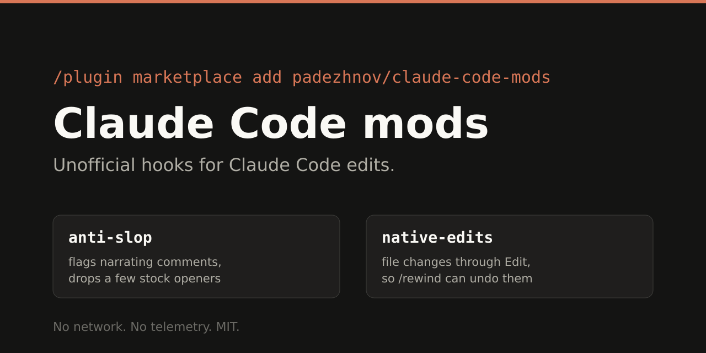

# Claude Code mods by Evgeny Padezhnov

*Unofficial — not made or endorsed by Anthropic.*



| Mod | What it does |
|---|---|
| [**anti-slop**](#anti-slop) | Flags comments that narrate the edit ("added X", "as requested") with a note to Claude right after the edit, and drops a few stock openers like "You're absolutely right" from stored replies. English and Russian. |
| [**native-edits**](#native-edits) | File changes through Edit and Write, not `sed -i` and heredocs: every change gets a diff, can be rewound and follows the path's rules. |

```
/plugin marketplace add padezhnov/claude-code-mods
/plugin install anti-slop@padezhnov
/plugin install native-edits@padezhnov
```

**Mods** are Claude Code plugins whose hooks are TypeScript functions running inside Claude Code (since 2.1.287). These need Claude Code **2.1.287 or newer**; native-edits' prompt fix applies from 2.1.289. Neither mod makes network requests. anti-slop is about 500 lines of TypeScript; native-edits about 2,200, most of it a shell parser (`plugins/native-edits/hooks/shell.ts`) — read them before installing.

**Settings:** `/plugin` → pick the mod → configure, or `pluginConfigs.<mod>` in your Claude Code settings. **Turn off or remove:** `/plugin disable anti-slop@padezhnov`, `/plugin uninstall anti-slop@padezhnov` (same for native-edits), or set its mode to `off`.

---

## anti-slop

Two long-running complaints about Claude Code: it writes comments that narrate the edit instead of explaining the code, and ignores instructions to stop ([#65961](https://github.com/anthropics/claude-code/issues/65961)); and it leans on stock phrases, such as opening with "You're absolutely right" or saying "load-bearing" ([#53454](https://github.com/anthropics/claude-code/issues/53454) is about the latter). English and Russian are both understood.

- **Comments.** After an edit succeeds, the comment lines it added are checked for ones that tell the history of the change: "Added retry logic", "I've removed…", "as requested", "used to return null", "until now…", "Добавил…", "Исправлено:", "по просьбе…". Claude gets a short note right then to rephrase those lines to describe the code as it is now, keeping the why. At most one note per file and three per session; the edit is never refused. Only files in common languages are checked (see `syntaxOf` in `plugins/anti-slop/hooks/slop.ts`). Quoted text, descriptions of what code does ("Updated by cron", "Token used to call the API", "Добавлено в v2 API"), tool directives, prose files and `/tmp` or scratchpad files are left alone.
- **Too many comments** is opt-in (`comments: density`): three or more short one-line captions right above code, at 30% or more of the code lines the edit added.
- **Phrases.** By default "Хороший вопрос", "Отличный вопрос", "You're absolutely right" or "You are absolutely right" where it starts a sentence is dropped from the reply as the conversation stores it (the copy Claude reads back on later turns), so Claude does not keep echoing itself; a sentence that needs the phrase ("You're absolutely right that the cache is stale") is kept. A short system-prompt section asks Claude to avoid all listed phrases in replies, code, comments and commit messages, and not to open a reply by agreeing with or praising you; "Ты прав", "Вы правы" and "load-bearing" are only covered by that request. Code spans, fences and text that looks like JSON are never rewritten, and what already streamed to your screen may still show the original.
- Changes made through Bash (`sed -i`, heredocs) are not seen; use it with [native-edits](#native-edits), which sends those to Edit and Write.
- `/anti-slop` shows the settings and what it caught, for this session and, approximately, for all sessions on this machine. Settings: `comments` (`narration`, `density` or `off`), `minComments`, `commentPercent`, `beforeNow` (also count Russian "раньше…" / "теперь…" history comments; off because many teams write these on purpose), `phrases` (`phrase=>replacement`, `phrase=>` to drop an opener, a bare phrase to only avoid), `rewrite`.

Replayed against my own Claude Code transcripts (one developer, about four weeks; 2,816 successful Edit and Write calls in that extract): 0.1 would have sent 141 notes; of 30 picked at random, none pointed at comments that only restate the code, 3 at a history sentence inside a longer explanation, and the rest at explanations of why, file headers and section markers. 0.2 sends 3 (4 before the caps), each for an "until now…" or "it used to…" sentence inside a long explanatory comment; no "// Added X" style comment turned up outside `/tmp`. The phrase rewrite changed 15 openers in 29,966 stored text blocks. Treat the comment rule as a light guard, not a cleaner.

---

## native-edits

In auto mode (Claude Code deciding permissions itself) and with bypassed permissions, Claude Code tells the model, in so many words, to "make small, mechanical file changes with sed, heredocs, or short scripts instead of the dedicated Read, Edit, or Write tools". So it does: on my machines about half of all local file changes went through Bash. `/rewind` cannot undo those changes ([#87575](https://github.com/anthropics/claude-code/issues/87575)), they skip the nested `CLAUDE.md` and path rules that Edit and Write load ([#90450](https://github.com/anthropics/claude-code/issues/90450)), and any hook or mod that checks Edit and Write never sees them. Related requests to keep Claude on its own file tools: [#19649](https://github.com/anthropics/claude-code/issues/19649), [#87971](https://github.com/anthropics/claude-code/issues/87971), [#88041](https://github.com/anthropics/claude-code/issues/88041). Claude Code does show a diff of what a Bash command changed, but only in auto and bypass mode and only inside a git repository.

- **The cause.** The auto-mode note is rewritten before the model reads it: reading and searching through Bash (`cat`, `sed -n`, `grep`) stays, file changes go to Edit (or Write for a new file). Claude Code adds that note in auto mode and with bypassed permissions, not in every session; in the same sessions it drops the "Edit files: Use Edit (NOT sed/awk)" lines from the Bash tool's description, and the mod puts an equivalent line back. Only the wording 2.1.289–2.1.294 uses is replaced; another build's note is left exactly as it is, and the guard below still applies.
- **The guard.** A Bash command that writes a file in your project is not run. Claude is told which files and to use Edit or Write instead; you are never asked. It catches `sed -i`, `perl -i`, `ruby -i`, `awk -i inplace` and `yq -i` (every target, also through `find -exec`, `xargs` and loops), `cat > f <<EOF`, `echo`/`printf` redirections, `tee`, `x > f.tmp && mv f.tmp f` when x is text Claude wrote or a filter of f itself, writes inside shell functions, and Python, Node or Deno snippets that rewrite a file or write literal text (`open(p, 'w')`, `writeFileSync`), including a script written to `/tmp` and run in the same command. Shell variables in those snippets are filled in as the shell would (`open('$S/x', 'w')` with `S=/tmp/…` is a scratch file).
- **When Claude has no Edit or Write tool** (`--disallowedTools Edit Write`, a headless run with Bash only), the write runs: a refusal would leave no way to make the change. A subagent's tools are not visible to the mod, so a subagent is refused once per command and told that the same command runs on a second try.
- **What it leaves alone:** reading and searching; `/tmp`, `$TMPDIR` and the session scratchpad; `/dev/null` and `2>&1`; files outside the project (setting `scope`); anything run on another machine (`ssh`, `scp`, `rsync`, `docker exec`); output of programs (`git diff > x.patch`, `npm test > out.txt`, `curl … > page.html`, `curl … | jq . > f.tmp && mv f.tmp f`, a script dumping computed JSON); content only known at run time (`echo "$(date)" >> f`, an unquoted heredoc with `$VAR`); paths only known at run time (`xargs -I{}`, an unset variable); and `allowPaths` (default `**/*.log,**/node_modules/**,**/dist/**,**/build/**`).
- A bulk change (`sed -i` over 15 files) is refused like any other: Claude then makes it with Edit. Use `warn` or `allowPaths` if you would rather let those through.
- `/native-edits` shows how many writes were refused, warned or let through, whether the auto-mode note was rewritten, and any `allowPaths` glob it could not read (an invalid glob is ignored, the rest still apply). Settings: `mode` (`deny`, `warn` runs the command and tells Claude afterwards, `off`), `scope` (`project` or `everywhere`), `allowPaths`, `rewritePrompt`.

Checked in a live session: asked to "change red to blue in file.txt using sed -i", Haiku's `sed -i` was refused, it read the file and made the change with Edit. With Edit and Write disallowed, the same `sed -i` ran. A `python3 - <<EOF` writing to `$T/probe.txt` with `T` set to a scratch directory ran. In auto mode, Opus quoted the rewritten note back instead of the original.

Replayed against all 20,197 Bash commands in my own transcripts (an earlier extract: 429 sessions and subagents): 2,090 commands would have been refused, writing 3,079 files, against 2,721 Edit and Write calls in the same sessions. Of 60 random refusals checked by hand, 59 were plain edits or new files Claude wrote through the shell and one was borderline (a manifest rewritten with computed hashes). Of 40 random commands that look like writes but were let through, none was a missed edit: they ran on another machine, saved a program's output, or wrote nothing. Writes to a path only known at run time (62 files, about 2% of the 3,079) are let through by design.

---

## Security

What each mod reads and changes, and how to report a problem: [SECURITY.md](SECURITY.md).

## Development

```
./scripts/check.sh   # claude plugin validate + tsc + claude plugin test (may make one short claude -p call to refresh the mods switch)
```

MIT licensed.
